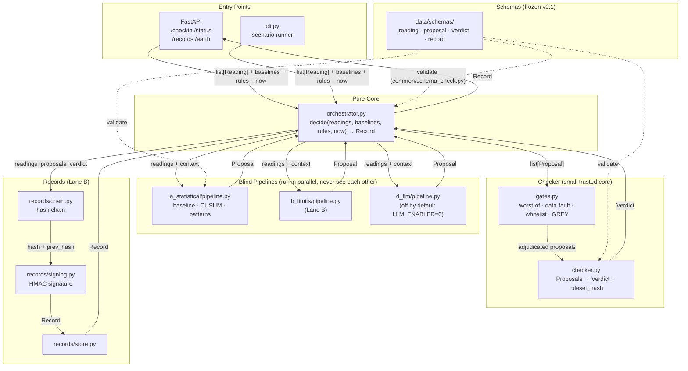
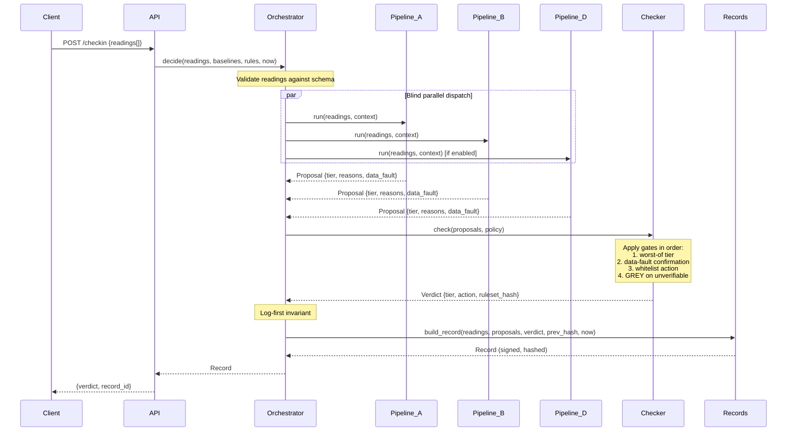

# Design Document: Lane A — Backend Decision

## Overview

AstroHealth's backend is the decision core of the NASA Space Apps 2026 health-monitoring system. It ingests physiological and environmental readings from an astronaut, runs them through two or more independent analytical pipelines, adjudicates those pipelines' proposals through a small trusted Checker, and writes a tamper-evident signed Record before displaying any verdict to the crew or ground.

Lane A owns the statistical pipeline (`a_statistical`), the LLM pipeline (`d_llm`), the Checker, the orchestrator, the FastAPI layer, and the CLI. Pipeline B (absolute limits) is owned by Lane B but feeds the same Checker, so the Checker gate design is a joint boundary. The fundamental design constraint is purity: `decide()` takes all inputs explicitly, has no hidden state, and returns a complete `Record`; Earth can replay the same call with the same inputs and get the same hash.

---

## Architecture



---

## Data Flow: Reading → Proposal → Verdict → Record



---

## Tier / Action Mapping Table

| Tier | Meaning | Default Actions (ascending severity) |
|------|---------|---------------------------------------|
| `GREEN` | All signals nominal | `NO_ACTION` |
| `YELLOW` | Drift or borderline reading | `RECHECK_IN_1H`, `REST_AND_HYDRATE` |
| `RED` | Actionable clinical concern | `USE_PROTOCOL_CARD`, `ALERT_CMO` |
| `GREY` | Unverifiable data — cannot rule out RED | `CONTACT_GROUND_URGENT` |

**Tier ordering for worst-of gate:** `GREEN < YELLOW < RED < GREY`

GREY sits above RED because an unknown state demands the same urgency as a known bad state.

---

## Pipeline Isolation Model

Each pipeline receives the same `(readings, context)` tuple and produces one `Proposal`. Isolation is enforced structurally:

- `decide()` calls each pipeline's `run()` function separately; return values are collected after all pipelines finish.
- No pipeline import path touches another pipeline's module.
- `context` passed to each pipeline contains only `baselines`, `rules`, and `now` — no reference to any other pipeline's output.
- The LLM pipeline is disabled by default (`LLM_ENABLED=0`). When enabled it still cannot read the other proposals.

Auto-discovery means adding a new pipeline never edits a shared registry file — only the new package directory is added under `backend/pipelines/`.

---

## Checker Gate Logic Overview

The Checker applies four gates in strict order. Each gate either passes or transforms the emerging verdict; later gates never undo earlier ones.

```
Gate 1 — Worst-Of Tier
  verdict.tier = max(proposal.tier for all proposals)
  Tier ordering: GREEN=0, YELLOW=1, RED=2, GREY=3

Gate 2 — Data-Fault Downgrade
  IF verdict.tier > GREEN
  AND ALL proposals agree data_fault=True
  THEN allow tier reduction by ONE level
  (can never go below GREEN; can never be used to drop RED→GREEN in one step)

Gate 3 — Action Whitelist
  verdict.action must be in policy.yaml::actions
  If chosen action is not on whitelist → escalate to next whitelisted action upward

Gate 4 — GREY Escalation
  IF any reading has quality=fault AND no pipeline asserts data_fault=True
  THEN set tier=GREY, action=CONTACT_GROUND_URGENT
  (unverifiable sensor that no pipeline flagged as a known fault)
```

---

## Components and Interfaces

### orchestrator.py

**Purpose**: The single pure entry point. Assembles context, dispatches pipelines, calls Checker, builds Record. No I/O.

**Interface**:
```python
def decide(
    readings: list[dict],       # validated against reading.schema.json
    baselines: dict,            # {astronaut_id: {channel: BaselineStats}}
    rules: dict,                # loaded from config.yaml + limits_table.yaml
    now: datetime,              # explicit clock — no datetime.now() inside
) -> dict:                      # validated Record
```

**Responsibilities**:
- Validate each reading against `reading.schema.json`
- Build the shared `context` dict (baselines, rules, now) — no proposal cross-references
- Dispatch all discovered pipelines and collect their `Proposal` dicts
- Call `checker.check(proposals, policy)`
- Build, sign, and return the `Record`

#### Stub-First Strategy (A-01 — unblocks Lanes B and C)

The first implementation of `decide()` returns a hardcoded fixture `Record` from `data/fixtures/sample_record.json` without calling any pipeline or the Checker. This is intentional: Lanes B (records, downlink) and C (frontend) need a live `/checkin` endpoint returning a correctly-shaped Record before the statistical pipeline and Checker are written.

**Stub implementation**:
```python
def decide(readings, baselines, rules, now):
    # STUB: returns fixture until A-02 through A-08 are complete
    with open(FIXTURE_PATH / "sample_record.json") as f:
        record = json.load(f)
    # Stamp the actual astronaut_id and timestamp so callers can test filtering
    record["astronaut_id"] = readings[0]["astronaut_id"] if readings else "crew_1"
    record["ts"] = now.isoformat() + "Z"
    return record
```

**Gate condition for removing the stub**: All of `gate_worst_of`, `gate_data_fault`, `gate_grey_escalation`, `gate_whitelist`, and `a_statistical.pipeline.run` have passing unit tests. Remove the stub by wiring the real pipeline dispatch and Checker call in one commit; the integration test (A-13) is the acceptance gate.

**Fixture contract**: The fixture Record must pass `record.schema.json` validation at all times — if the schema changes, update the fixture in the same commit.

---

### pipelines/\_\_init\_\_.py — Auto-Discovery

**Purpose**: Find all pipeline subpackages without a central registry.

**Interface**:
```python
def discover_pipelines() -> list[types.ModuleType]:
    """
    Returns modules that expose run(readings, context) -> Proposal.
    Searches backend/pipelines/ for subpackages with a pipeline.py
    that exports a callable 'run'.
    Respects LLM_ENABLED env var; skips d_llm when 0.
    """
```

**Discovery mechanism**: `pkgutil.iter_modules` over the `pipelines` package path; for each subpackage, attempt `importlib.import_module(".pipeline", package)` and check for `run` callable. No explicit list in any file.

---

### a\_statistical/baseline.py

**Purpose**: Compute per-channel personal baselines from pre-flight blood draws and sensor data; return a confidence band that widens when draw count is low.

**Interface**:
```python
class BaselineStats:
    mean: float
    std: float
    n: int              # number of pre-flight draws
    low: float          # lower bound of confidence band
    high: float         # upper bound of confidence band
    confidence: str     # "high" (n>=10) | "medium" (n>=4) | "low" (n<4)

def compute_baseline(draws: list[float]) -> BaselineStats:
    """
    Returns BaselineStats. If n < 2, std defaults to population-level fallback.
    """

def load_baselines(astronaut_id: str, draws_path: str) -> dict[str, BaselineStats]:
    """
    Returns {channel: BaselineStats} for a given astronaut.
    """
```

---

### a\_statistical/cusum.py

**Purpose**: Tabular CUSUM (Page's test) drift detection on a single channel's time-ordered readings.

**Interface**:
```python
class CUSUMState:
    s_pos: float    # upper cumulative sum
    s_neg: float    # lower cumulative sum

def cusum_update(
    state: CUSUMState,
    value: float,
    mean: float,
    std: float,
    k: float,       # allowance (slack) parameter, default 0.5
) -> CUSUMState:
    """Pure update. Returns new state; does not mutate input."""

def cusum_alarm(state: CUSUMState, h: float) -> bool:
    """True if s_pos > h or s_neg < -h."""

def run_cusum_series(
    values: list[float],
    mean: float,
    std: float,
    k: float,
    h: float,
) -> tuple[bool, list[CUSUMState]]:
    """
    Runs CUSUM over the full series.
    Returns (alarm_triggered, state_history).
    """
```

---

### a\_statistical/patterns.py

**Purpose**: Multi-channel pattern detection rules loaded from `config.yaml`.

**Interface**:
```python
class PatternMatch:
    rule_id: str
    matched: bool
    reasons: list[str]
    tier: str           # tier this pattern contributes if matched

def evaluate_patterns(
    readings: list[dict],
    baselines: dict[str, BaselineStats],
    rules: list[dict],      # loaded from config.yaml::patterns
) -> list[PatternMatch]:
    """
    Evaluates each pattern rule against the current reading window.
    A pattern fires when ALL its channel conditions are satisfied.
    """
```

**Pattern structure in config.yaml**:
```yaml
patterns:
  - id: "fatigue_cluster"
    tier: "YELLOW"
    conditions:
      - channel: sleep_hours   op: lt   threshold: 6.0
      - channel: mood          op: lt   threshold: 4.0
      - channel: co2_ppm       op: gt   threshold: 1200
```

---

### a\_statistical/pipeline.py

**Purpose**: Compose baseline, CUSUM, and pattern modules into a single `Proposal`.

**Interface**:
```python
def run(
    readings: list[dict],
    context: dict,      # keys: baselines, rules, now
) -> dict:              # validated against proposal.schema.json
```

**Responsibilities**:
- Load `BaselineStats` from `context["baselines"]`
- Run CUSUM on each channel with available history
- Evaluate patterns
- Merge results into the worst-of tier across channels/patterns
- Return schema-valid `Proposal` with `pipeline_id="a_statistical"`

---

### checker/gates.py

**Purpose**: The four gate functions; each is a pure transformation of a list of proposals into a modified verdict state.

**Interface**:
```python
def gate_worst_of(proposals: list[dict]) -> str:
    """Returns the maximum tier across all proposals."""

def gate_data_fault(
    proposals: list[dict],
    current_tier: str,
) -> str:
    """
    Returns potentially lowered tier if ALL proposals flag data_fault=True.
    Can lower by at most one step. Never below GREEN.
    """

def gate_whitelist(action: str, policy_actions: list[str]) -> str:
    """
    Returns action if whitelisted, else the next-higher action on the list.
    """

def gate_grey_escalation(
    readings: list[dict],
    proposals: list[dict],
    current_tier: str,
) -> str:
    """
    Returns GREY if any reading has quality=fault and no proposal declares
    data_fault=True for that reading. Otherwise returns current_tier unchanged.
    """
```

---

### checker/checker.py

**Purpose**: Apply gates in order and produce a single `Verdict`.

**Interface**:
```python
def check(
    proposals: list[dict],
    readings: list[dict],
    policy_path: str,
) -> dict:              # validated against verdict.schema.json
    """
    1. Load policy.yaml; compute SHA-256 of file bytes → ruleset_hash
    2. Apply gates in order: worst_of → data_fault → grey_escalation → whitelist
    3. Select default action for the resulting tier
    4. Return Verdict with checker_version, ruleset_hash
    """

def _hash_policy(policy_path: str) -> str:
    """SHA-256 hex digest of policy.yaml bytes."""

def _default_action(tier: str) -> str:
    """Canonical default action per tier from policy.yaml."""
```

---

### api/main.py and routes/

**Purpose**: Thin FastAPI layer. No business logic; all decisions go through `decide()`.

#### File Tree

```
backend/api/
├── __init__.py
├── main.py                  # app = FastAPI(); includes all routers; loads baselines + policy at startup
└── routes/
    ├── __init__.py
    ├── checkin.py           # POST /checkin — the hot path; calls decide()
    ├── status.py            # GET /status/{astronaut_id} — reads last Record from store
    ├── records.py           # GET /records, GET /records/{record_id} — read-only record access
    └── earth.py             # GET /earth/verify, POST /earth/replay, POST /earth/review, POST /earth/rulechange
```

#### Route File Responsibilities

**`routes/checkin.py`**
- Validates request body (astronaut_id + readings list) with Pydantic model
- Resolves baselines and rules from app-state loaded at startup
- Calls `decide(readings, baselines, rules, now=datetime.utcnow())`
- Returns `{record_id, verdict}` — never the full Record (keep payload small for downlink)
- Raises HTTP 422 on schema validation failure before `decide()` is ever called

**`routes/status.py`**
- Reads the most recent `Record` for the given astronaut from `records/store.py`
- Returns `{tier, action, reasons, record_id}` only — no raw readings in response
- Returns HTTP 404 if no records exist for that astronaut

**`routes/records.py`**
- `GET /records?astronaut_id=&limit=` — paginated list of Records (most-recent-first)
- `GET /records/{record_id}` — single full Record including hash and signature
- Read-only; writes happen only through checkin

**`routes/earth.py`**
- `GET /earth/verify/{record_id}` — walks the hash chain from genesis to the requested record; returns `{valid: bool, broken_at: str|null}`
- `POST /earth/replay` — calls `decide()` with the original record's inputs plus an optional `rules_override`; returns new Record for comparison
- `POST /earth/review` — attaches a `Review` object (CMO note, timestamp) to a Record; delegates to `backend/earth/review.py`
- `POST /earth/rulechange` — runs `backend/earth/rulechange.py` over all past records with a proposed rule change; returns diff table

**`main.py`**
- Creates the FastAPI application instance
- Registers all four routers with their prefixes (`/checkin`, `/status`, `/records`, `/earth`)
- Loads and caches at startup: compiled JSON schema validators, baselines dict, policy actions list
- Exposes `GET /health` returning `{"ok": true}` for readiness checks

**Interface (routes)**:

| Route | Method | Request | Response |
|-------|--------|---------|----------|
| `/checkin` | POST | `{astronaut_id, readings[]}` | `{record_id, verdict}` |
| `/status/{astronaut_id}` | GET | — | `{tier, action, reasons, record_id}` |
| `/records` | GET | `?astronaut_id=&limit=` | `[Record]` |
| `/records/{record_id}` | GET | — | `Record` |
| `/earth/verify/{record_id}` | GET | — | `{valid: bool, broken_at: str|null}` |
| `/earth/replay` | POST | `{record_id, rules_override?}` | `Record` |
| `/earth/review` | POST | `{record_id, cmo_note}` | `Review` |

Each route handler: validate input → call orchestrator or records layer → return schema-valid response. HTTP 422 on schema failure, HTTP 500 with structured error on unexpected fault.

---

### cli.py

**Purpose**: Scenario runner called by `evidence/` scripts and usable directly for manual testing. The CLI is the bridge between the pure `decide()` core and the ablation, sensitivity, replay, and rule-change evidence runners.

**Interface**:
```python
# python -m backend.cli run-scenario <scenario_file>
#     [--limits-file <path>]   override b_limits/limits_table.yaml
#     [--config <path>]        override a_statistical/config.yaml
#     [--out <dir>]            write Records as JSON files to this dir (default: stdout)
#     [--seed <int>]           fix random seed for reproducibility

# python -m backend.cli replay <record_id_or_file>
#     [--rules <path>]         re-run decide() with an alternate rules dict
#     [--limits-file <path>]   same as above for the limits table
#     [--out <dir>]

# python -m backend.cli dump-records
#     [--astronaut <id>]       filter by astronaut_id
#     [--format json|csv]      output format (default: json)

def run_scenario(
    scenario_path: str,
    limits_file: str | None,
    config_path: str | None,
    out_dir: str,
    seed: int | None,
) -> list[dict]:               # list of Records, one per event in the scenario
    ...

def replay(
    record_id_or_path: str,
    rules_path: str | None,
    limits_file: str | None,
    out_dir: str,
) -> dict:                     # new Record from the same inputs
    ...

def dump_records(
    astronaut_id: str | None,
    fmt: str,
) -> None: ...
```

#### How the CLI integrates with `evidence/`

The `evidence/` scripts never call `decide()` directly — they go through the CLI to get the same environment setup (schema loading, baseline loading, policy hash) that the API uses.

| Evidence script | CLI subcommand used | Key flag |
|----------------|---------------------|----------|
| `evidence/ablation.py` | `run-scenario` | `--config` (disable CUSUM or patterns selectively by passing a minimal config) |
| `evidence/sensitivity.py` | `run-scenario` | `--limits-file` (swaps in ±20% threshold variants) |
| `evidence/rulechange_replay.py` | `replay` | `--rules` (applies proposed rule change to past records) |
| `evidence/downlink_efficiency.py` | `dump-records` | `--format json` (counts bytes in Record payloads) |
| `evidence/run_all.py` | all of the above | `--seed 42` (fixed seed for reproducibility) |

**`--limits-file` flag in detail**: Accepts a local path to a YAML file with the same schema as `b_limits/limits_table.yaml`. The file is loaded and passed into `context["rules"]` before `decide()` is called, completely replacing the default limits table. This allows `evidence/sensitivity.py` to sweep every threshold ±20% and report the number of unsafe approvals (verdicts that should have been RED but came back GREEN) for each variant.

**Scenario file format** (`data/scenarios/*.json`):
```json
{
  "id": "storm_day",
  "description": "...",
  "events": [
    {
      "ts": "2026-11-14T08:00:00Z",
      "readings": [ /* list of Reading objects */ ]
    }
  ]
}
```

Each event in the scenario is passed as a separate `decide()` call in timestamp order. The Records link via `prev_hash` exactly as in the live API, making the CLI replay forensically equivalent to the original run.

---

### d\_llm/prompt.md

Encodes three hard constraints for the LLM:
1. Output JSON only, matching `proposal.schema.json`
2. May set `tier` to the same level as or higher than any non-LLM proposal, never lower
3. Must never mention or suggest a dose, drug, or specific treatment

---

### d\_llm/parser.py

**Interface**:
```python
def parse_llm_response(raw: str) -> dict | None:
    """
    Attempts to extract and validate a Proposal from raw LLM output.
    Returns None (and logs warning) if:
      - raw contains no valid JSON block
      - extracted JSON fails proposal.schema.json validation
    Never raises; discards bad output silently after logging.
    """
```

---

### d\_llm/pipeline.py

**Interface**:
```python
def run(readings: list[dict], context: dict) -> dict | None:
    """
    Returns None if LLM_ENABLED != '1'.
    Calls LLM with structured prompt; passes raw output to parser.
    Returns Proposal or None (discarded on parse failure).
    """
```

The orchestrator skips `None` proposals. A failed LLM call is not an error — the other pipelines carry the decision.

---

## Data Models

### Reading (frozen v0.1)

```python
{
  "id": str,              # required
  "astronaut_id": str,    # required
  "ts": str,              # ISO-8601, required
  "channel": Literal[    # required
    "bp_systolic", "bp_diastolic", "heart_rate", "glucose",
    "temperature", "sleep_hours", "mood", "co2_ppm",
    "exercise_minutes", "dose_rate_usv_h", "blood_analyte"
  ],
  "value": float,         # required
  "unit": str,            # required
  "source": Literal[      # required
    "simulated", "nasa_osdr", "nasa_radlab", "nasa_donki", "manual"
  ],
  "analyte": str,         # optional (for blood_analyte channel)
  "quality": Literal["ok", "suspect", "fault"],  # optional
  "provenance": {         # optional
    "dataset_id": str, "field": str, "timestamp": str
  }
}
```

### Proposal (frozen v0.1)

```python
{
  "pipeline_id": str,         # required
  "tier": Literal["GREEN", "YELLOW", "RED", "GREY"],  # required
  "reasons": list[str],       # required, non-empty recommended
  "data_fault": bool,         # required
  "reading_ids": list[str],   # optional
  "rule_ids": list[str],      # optional
}
```

### Verdict (frozen v0.1)

```python
{
  "tier": Literal["GREEN", "YELLOW", "RED", "GREY"],  # required
  "action": Literal[          # required, must be in policy.yaml::actions
    "NO_ACTION", "RECHECK_IN_1H", "REST_AND_HYDRATE",
    "USE_PROTOCOL_CARD", "ALERT_CMO", "CONTACT_GROUND_URGENT"
  ],
  "reasons": list[str],       # required
  "checker_version": str,     # required, semver string
  "ruleset_hash": str,        # required, SHA-256 of policy.yaml
  "overruled_pipelines": list[str],  # optional
}
```

### Record (frozen v0.1)

```python
{
  "id": str,                  # required, UUID
  "prev_hash": str,           # required, "GENESIS" for first record
  "ts": str,                  # required, ISO-8601
  "astronaut_id": str,        # required
  "readings": list[Reading],  # required
  "proposals": list[Proposal],# required
  "verdict": Verdict,         # required
  "versions": dict[str, str], # required, e.g. {"checker": "0.1.0"}
  "hash": str,                # required, SHA-256 of canonical serialization
  "signature": str,           # required, HMAC-SHA256 of hash
  "provenance": list[...],    # optional
  "explanation": str,         # optional
}
```

---

## Low-Level Design: Algorithms and Formal Specifications

### CUSUM Algorithm (Page's Test)

CUSUM detects persistent drift away from a known baseline, triggering an alarm when cumulative deviation exceeds threshold `h`.

```
ALGORITHM cusum_update(state, value, mean, std, k)
INPUT:
  state  : CUSUMState  (s_pos >= 0, s_neg <= 0)
  value  : float       (current sensor reading)
  mean   : float       (personal baseline mean)
  std    : float       (personal baseline std, > 0)
  k      : float       (allowance parameter, typically 0.5)

OUTPUT: new_state : CUSUMState

PRECONDITIONS:
  std > 0
  k > 0
  state.s_pos >= 0
  state.s_neg <= 0

POSTCONDITIONS:
  new_state.s_pos >= 0
  new_state.s_neg <= 0
  new_state != state  (always a fresh object; input not mutated)

BEGIN
  z ← (value - mean) / std          // standardize
  s_pos ← max(0, state.s_pos + z - k)
  s_neg ← min(0, state.s_neg + z + k)
  RETURN CUSUMState(s_pos=s_pos, s_neg=s_neg)
END

ALGORITHM cusum_alarm(state, h)
INPUT:  state : CUSUMState,  h : float (> 0)
OUTPUT: alarm : bool
BEGIN
  RETURN (state.s_pos > h) OR (state.s_neg < -h)
END
```

**Loop invariant for `run_cusum_series`**: After processing index `i`, `state_history[i].s_pos >= 0` and `state_history[i].s_neg <= 0` for all `i` processed so far.

**Default parameters** (from `config.yaml`):
- `k = 0.5` (half-sigma allowance — standard for biomedical CUSUM)
- `h = 4.0` (alarm threshold — four sigma equivalent accumulation)

**Rationale for defaults**: `k = 0.5` is the standard choice for detecting a 1σ shift with reasonable average run length (ARL ≈ 168 false alarms per unit under H₀, ARL ≈ 10.4 to detect a 1σ shift). `h = 4.0` is the matching threshold that keeps the in-control ARL above 100 — acceptable for a polling interval of minutes. These are the CUSUM parameters from Lucas & Crosier (1982) for the biomedical monitoring context.

**`config.yaml` values to set** (replacing current nulls):
```yaml
cusum: {k: 0.5, h: 4.0}
```

The `patterns` list stays empty until specific multi-channel rules are confirmed from NASA data; the CUSUM defaults give the pipeline meaningful signal from day one.

---

### Baseline Confidence Formula

```
ALGORITHM compute_baseline(draws)
INPUT:  draws : list[float]   (pre-flight measurements for one channel)
OUTPUT: stats : BaselineStats

PRECONDITIONS:
  len(draws) >= 1

POSTCONDITIONS:
  stats.n == len(draws)
  stats.low <= stats.mean <= stats.high
  stats.std >= 0

BEGIN
  n    ← len(draws)
  mean ← sum(draws) / n

  IF n >= 2 THEN
    std ← sqrt(sum((x - mean)^2 for x in draws) / (n - 1))  // sample std
  ELSE
    std ← POPULATION_FALLBACK_STD[channel]  // conservative population value
  END IF

  // Confidence band widens with fewer draws
  // Uses t-distribution critical value for n-1 degrees of freedom at 95%
  IF n >= 10 THEN
    multiplier ← 2.0        // ~2 sigma, high confidence
    confidence ← "high"
  ELSE IF n >= 4 THEN
    multiplier ← 3.0        // wider band, medium confidence
    confidence ← "medium"
  ELSE
    multiplier ← 4.0        // very wide band, low confidence
    confidence ← "low"
  END IF

  low  ← mean - multiplier * std
  high ← mean + multiplier * std

  RETURN BaselineStats(mean, std, n, low, high, confidence)
END
```

**Rationale**: Wider bands for low-draw astronauts avoid false positives when baseline is uncertain. The pipeline raises tier only after the value leaves the confidence band, so a "low" confidence baseline is harder to alarm.

---

### Gate Precedence Rules (Low-Level)

```
ALGORITHM apply_gates(proposals, readings, policy_path)
INPUT:
  proposals   : list[Proposal]   (non-empty)
  readings    : list[Reading]
  policy_path : str

OUTPUT: verdict : Verdict

PRECONDITIONS:
  len(proposals) >= 1
  policy_path is readable and contains valid YAML

POSTCONDITIONS:
  verdict.tier in {GREEN, YELLOW, RED, GREY}
  verdict.action in policy.actions
  verdict.ruleset_hash == SHA256(policy_path bytes)

BEGIN
  // Gate 1: Worst-of
  TIER_ORDER ← {GREEN: 0, YELLOW: 1, RED: 2, GREY: 3}
  tier ← proposals[0].tier
  FOR each p IN proposals DO
    IF TIER_ORDER[p.tier] > TIER_ORDER[tier] THEN
      tier ← p.tier
    END IF
  END FOR

  // Gate 2: Data-fault downgrade (requires unanimous agreement)
  IF tier != GREEN
  AND ALL(p.data_fault == True for p in proposals)
  THEN
    // Lower by exactly one step
    TIER_DOWN ← {GREY: RED, RED: YELLOW, YELLOW: GREEN}
    tier ← TIER_DOWN[tier]
  END IF

  // Gate 3: GREY escalation on unverifiable sensor fault
  fault_reading_ids ← {r.id for r in readings WHERE r.quality == "fault"}
  pipeline_fault_reading_ids ← UNION of p.reading_ids for p in proposals WHERE p.data_fault == True
  unverified_faults ← fault_reading_ids - pipeline_fault_reading_ids
  IF len(unverified_faults) > 0 THEN
    IF TIER_ORDER[tier] < TIER_ORDER[GREY] THEN
      tier ← GREY
    END IF
  END IF

  // Gate 4: Action selection + whitelist enforcement
  action ← DEFAULT_ACTION[tier]
  IF action NOT IN policy.actions THEN
    // Escalate to next whitelisted action
    action ← first action IN policy.actions WHERE severity(action) > severity(DEFAULT_ACTION[tier])
  END IF

  ruleset_hash ← SHA256(read_bytes(policy_path))

  RETURN Verdict(tier, action, reasons, CHECKER_VERSION, ruleset_hash)
END
```

---

### Auto-Discovery Mechanism (Low-Level)

```
ALGORITHM discover_pipelines()
INPUT:  (none — inspects filesystem at import time)
OUTPUT: modules : list[Module]

BEGIN
  base_path ← dirname(pipelines/__init__.py)
  modules ← []

  FOR each (finder, name, ispkg) IN pkgutil.iter_modules([base_path]) DO
    IF NOT ispkg THEN
      CONTINUE
    END IF

    IF name == "d_llm" AND env("LLM_ENABLED") != "1" THEN
      CONTINUE
    END IF

    full_name ← "backend.pipelines." + name + ".pipeline"
    TRY
      mod ← importlib.import_module(full_name)
      IF callable(getattr(mod, "run", None)) THEN
        modules.append(mod)
      END IF
    EXCEPT ImportError
      log warning and continue
    END TRY
  END FOR

  RETURN modules
END
```

**Invariant**: The discovery result is deterministic for a given filesystem state and `LLM_ENABLED` value.

---

### LLM Parser (Low-Level)

```
ALGORITHM parse_llm_response(raw)
INPUT:  raw : str   (raw LLM text output)
OUTPUT: proposal : dict | None

BEGIN
  // Extract first JSON object from raw (may be wrapped in markdown code fence)
  json_str ← extract_first_json_block(raw)

  IF json_str IS None THEN
    log.warning("LLM response contains no JSON block")
    RETURN None
  END IF

  TRY
    obj ← json.loads(json_str)
  EXCEPT json.JSONDecodeError
    log.warning("LLM JSON parse failure")
    RETURN None
  END TRY

  TRY
    jsonschema.validate(obj, proposal_schema)
  EXCEPT jsonschema.ValidationError as e
    log.warning("LLM proposal fails schema: " + str(e))
    RETURN None
  END TRY

  RETURN obj
END
```

---

## Error Handling

### Schema Validation Failure (Reading)

**Condition**: A reading submitted to `/checkin` fails `reading.schema.json` validation.
**Response**: HTTP 422 with field-level error detail. `decide()` is never called.
**Recovery**: Client corrects the payload and resubmits.

### Pipeline Run-time Exception

**Condition**: A pipeline's `run()` raises an unhandled exception.
**Response**: The pipeline is treated as returning a `GREY` proposal with `data_fault=False`. The other pipelines' proposals still flow through the Checker.
**Rationale**: A silent pipeline is a form of unverifiable data — treat it conservatively.

### LLM Parse Failure

**Condition**: LLM returns unparseable or schema-invalid output.
**Response**: The LLM proposal is discarded. The remaining proposals are sufficient. A warning is logged with the raw response (truncated to 500 chars).
**Recovery**: No action required. The system degrades gracefully.

### Hash Chain Break

**Condition**: `records/chain.py` detects a hash mismatch during verify.
**Response**: `/earth/verify/{record_id}` returns `{valid: false, broken_at: <id>}`. The chain is read-only after the fact; no automatic repair.

### Policy File Missing

**Condition**: `checker.py` cannot read `policy.yaml` at startup.
**Response**: Application startup fails with a clear error. The app will not serve requests without a valid policy.

---

## Testing Strategy

### Test File Responsibility Mapping (A-12)

Each test file owns a single module boundary. Cross-module concerns (orchestrator end-to-end) live in the integration test (A-13).

| Test file | Module(s) under test | Test types | Key focus |
|-----------|---------------------|------------|-----------|
| `test_a_statistical.py` | `baseline.py`, `cusum.py`, `patterns.py`, `pipeline.py` | Unit + PBT | CUSUM math, baseline confidence, pattern firing, schema-valid output |
| `test_checker.py` | `gates.py`, `checker.py` | Unit + PBT (heaviest) | Gate ordering, safety invariants, whitelist enforcement, GREY escalation |
| `test_api.py` | `api/main.py` + all routes | Integration (in-process) | HTTP contract, 422 paths, stub Record shape, all 7 routes |
| `test_d_llm.py` | `d_llm/parser.py`, `d_llm/pipeline.py` | Unit + fuzz-style | Parser robustness, schema enforcement, LLM-disabled path, tier-monotonicity |

**`test_checker.py` is the heaviest test file** because the Checker is the small trusted core. Every gate function gets both table-driven example tests (from `data/fixtures/`) and property-based tests with generated Proposal lists.

### Unit Testing

Each module tested in isolation with mocked dependencies:
- `baseline.py`: property tests over arbitrary draw lists
- `cusum.py`: property tests for monotonicity under drift, state immutability
- `patterns.py`: table-driven tests for each pattern in `config.yaml`
- `gates.py`: property tests (see below)
- `checker.py`: scenario table driven from fixture proposals
- `parser.py`: fuzzing-style tests with malformed LLM output
- Routes: `httpx.AsyncClient` against in-process FastAPI test app

### Property-Based Testing

**Library**: `hypothesis` (Python)

The properties below are written as executable Hypothesis specifications. Each includes the strategy to generate inputs and the invariant to assert.

#### test_checker.py properties

```python
from hypothesis import given, assume
from hypothesis import strategies as st

TIERS = ["GREEN", "YELLOW", "RED", "GREY"]
TIER_ORDER = {"GREEN": 0, "YELLOW": 1, "RED": 2, "GREY": 3}
ACTIONS = ["NO_ACTION", "RECHECK_IN_1H", "REST_AND_HYDRATE",
           "USE_PROTOCOL_CARD", "ALERT_CMO", "CONTACT_GROUND_URGENT"]

proposal_st = st.fixed_dictionaries({
    "pipeline_id": st.text(min_size=1, max_size=20),
    "tier": st.sampled_from(TIERS),
    "reasons": st.lists(st.text(min_size=1), min_size=1, max_size=5),
    "data_fault": st.booleans(),
    "reading_ids": st.lists(st.uuids().map(str), max_size=4),
})

reading_st = st.fixed_dictionaries({
    "id": st.uuids().map(str),
    "astronaut_id": st.just("crew_1"),
    "ts": st.just("2026-11-14T08:00:00Z"),
    "channel": st.sampled_from(["heart_rate", "bp_systolic", "glucose"]),
    "value": st.floats(min_value=0, max_value=300, allow_nan=False),
    "unit": st.just("bpm"),
    "source": st.just("simulated"),
    "quality": st.sampled_from(["ok", "suspect", "fault"]),
})

@given(proposals=st.lists(proposal_st, min_size=1, max_size=8))
def test_worst_of_gate(proposals):
    """verdict.tier is never lower than the worst proposal tier."""
    tier = gate_worst_of(proposals)
    assert TIER_ORDER[tier] == max(TIER_ORDER[p["tier"]] for p in proposals)

@given(proposals=st.lists(proposal_st, min_size=1, max_size=8),
       readings=st.lists(reading_st, min_size=1, max_size=4))
def test_action_whitelist(proposals, readings):
    """verdict.action is always in policy.actions."""
    verdict = check(proposals, readings, POLICY_PATH)
    assert verdict["action"] in ACTIONS

@given(proposals=st.lists(proposal_st, min_size=1, max_size=8))
def test_data_fault_safety(proposals):
    """Tier can only be lowered when ALL proposals agree data_fault=True."""
    worst = gate_worst_of(proposals)
    after_fault = gate_data_fault(proposals, worst)
    if TIER_ORDER[after_fault] < TIER_ORDER[worst]:
        assert all(p["data_fault"] for p in proposals)

@given(proposals=st.lists(proposal_st, min_size=2, max_size=8).filter(
           lambda ps: any(p["pipeline_id"] == "d_llm" for p in ps)))
def test_llm_never_lowers(proposals):
    """LLM proposal tier must be >= the worst non-LLM proposal tier."""
    llm = next(p for p in proposals if p["pipeline_id"] == "d_llm")
    others = [p for p in proposals if p["pipeline_id"] != "d_llm"]
    if others:
        worst_non_llm = max(TIER_ORDER[p["tier"]] for p in others)
        assert TIER_ORDER[llm["tier"]] >= worst_non_llm

@given(readings=st.lists(reading_st.map(lambda r: {**r, "quality": "fault"}),
                          min_size=1, max_size=4),
       proposals=st.lists(proposal_st.map(lambda p: {**p, "data_fault": False}),
                           min_size=1, max_size=4))
def test_grey_escalation_on_unverified_fault(readings, proposals):
    """Unverified fault readings (quality=fault, no pipeline claims data_fault) must produce GREY."""
    # Ensure no proposal claims the fault reading ids
    for p in proposals:
        p["reading_ids"] = []  # no overlap with fault reading ids
    tier = gate_grey_escalation(readings, proposals, "GREEN")
    assert tier == "GREY"
```

#### test_a_statistical.py properties

```python
@given(values=st.lists(st.floats(min_value=-10, max_value=10, allow_nan=False),
                        min_size=1, max_size=50),
       mean=st.floats(min_value=-5, max_value=5, allow_nan=False),
       std=st.floats(min_value=0.1, max_value=5, allow_nan=False),
       k=st.floats(min_value=0.1, max_value=2.0, allow_nan=False),
       h=st.floats(min_value=1.0, max_value=10.0, allow_nan=False))
def test_cusum_state_invariant(values, mean, std, k, h):
    """s_pos >= 0 and s_neg <= 0 after every update."""
    state = CUSUMState(s_pos=0.0, s_neg=0.0)
    for v in values:
        state = cusum_update(state, v, mean, std, k)
        assert state.s_pos >= 0
        assert state.s_neg <= 0

@given(draws=st.lists(st.floats(min_value=0, max_value=200, allow_nan=False),
                       min_size=1, max_size=30))
def test_baseline_confidence_band_contains_mean(draws):
    """Confidence band always contains the mean."""
    stats = compute_baseline(draws)
    assert stats.low <= stats.mean <= stats.high

@given(draws=st.lists(st.floats(min_value=0, max_value=200, allow_nan=False),
                       min_size=10, max_size=30))
def test_more_draws_narrower_band(draws):
    """Adding draws to an already-high-confidence baseline does not widen the band."""
    stats_n = compute_baseline(draws)
    stats_n1 = compute_baseline(draws + [draws[0]])  # one extra draw
    # Multiplier cannot increase once already at "high" confidence (n>=10)
    if stats_n.confidence == "high" and stats_n1.confidence == "high":
        band_n = stats_n.high - stats_n.low
        band_n1 = stats_n1.high - stats_n1.low
        # Band may shrink or stay same as std refines; it cannot grow wildly
        assert band_n1 <= band_n * 1.1  # allow 10% float tolerance

@given(readings=st.lists(reading_st, min_size=1, max_size=10))
def test_pipeline_a_always_schema_valid(readings):
    """a_statistical.run() output always validates against proposal.schema.json."""
    proposal = run(readings, context={"baselines": {}, "rules": {}, "now": datetime.utcnow()})
    jsonschema.validate(proposal, proposal_schema)
```

#### test_d_llm.py properties

```python
@given(raw=st.text(max_size=2000))
def test_parser_never_raises(raw):
    """parse_llm_response never raises; returns None on bad input."""
    result = parse_llm_response(raw)
    assert result is None or isinstance(result, dict)

@given(raw=st.text(max_size=2000))
def test_parser_output_always_schema_valid(raw):
    """When parser returns a dict, it validates against proposal.schema.json."""
    result = parse_llm_response(raw)
    if result is not None:
        jsonschema.validate(result, proposal_schema)
```

### Integration Test: Storm Day (A-13)

**Scenario** (`data/scenarios/storm_day.json`):
1. Load storm day readings (elevated `dose_rate_usv_h`, declining `mood` and `sleep_hours`)
2. POST to `/checkin` via `httpx.AsyncClient` against in-process app
3. Assert: `verdict.tier` is `RED` or `GREY`
4. Assert: `verdict.action` is `ALERT_CMO` or `CONTACT_GROUND_URGENT`
5. Assert: returned `record.hash` is consistent (re-hash and compare)
6. Assert: `record.signature` is valid HMAC
7. Assert: `record.prev_hash` links to the last stored record
8. Assert: `decide()` called a second time with the same inputs returns a record with the same `verdict` (determinism)

---

## Performance Considerations

- `decide()` is synchronous and CPU-bound; at hackathon scale (single astronaut, polling interval ≥ 1 minute) no async needed inside the pure core.
- Pipeline dispatch in the orchestrator can be sequential; parallelism would require thread safety guarantees not worth the complexity for this scope.
- Schema validation via `jsonschema` is acceptable for the read frequency; cache the compiled validator objects at module level.

---

## Security Considerations

- Record signing uses HMAC-SHA256 with a shared key (stated limitation in `signing.py` docstring). Acceptable for demo; flag for asymmetric upgrade post-hackathon.
- `policy.yaml` hash in every Verdict ensures ground control can detect policy tampering.
- LLM prompt is in `prompt.md` (plain text, versioned). The parser enforces schema before any LLM output reaches the Checker, so prompt injection cannot produce a structurally invalid Proposal.
- `--limits-file` CLI override accepts a local path; no URL fetch, no shell interpolation.

---

## Dependencies

| Package | Purpose |
|---------|---------|
| `fastapi` | HTTP framework |
| `uvicorn[standard]` | ASGI server |
| `pydantic>=2` | Request/response models in API layer |
| `jsonschema` | Validate objects against frozen schemas |
| `pyyaml` | Load `config.yaml`, `policy.yaml`, `limits_table.yaml` |
| `numpy` | CUSUM, baseline statistics |
| `httpx` | Test client for API routes |
| `pytest` | Test runner |
| `hypothesis` | Property-based testing |
| LLM SDK | Optional; add to `requirements.txt` if `d_llm` enabled |
